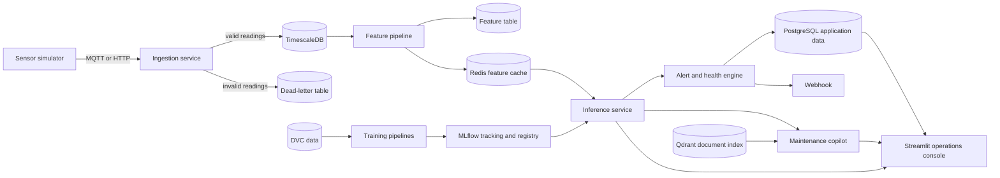

# FactoryPulse Architecture

## System overview

FactoryPulse separates telemetry transport, time-series storage, model
development, model serving, maintenance guidance, and operator workflows into
independent components. Each application component can be developed and scaled
without coupling it to the console.

## Component responsibilities

- **Simulator:** Replays prepared data over MQTT or HTTP. M1 provides the
  package scaffold and configuration.
- **Ingestion:** Validates telemetry and batches database writes. M1 provides
  the API and MQTT package scaffold.
- **TimescaleDB:** Stores raw telemetry and time-window aggregates. M1 provides
  the schema and Compose service.
- **Feature pipeline:** Computes rolling, spectral, and trend features. M1
  provides the shared ML package scaffold.
- **Training:** Trains anomaly, RUL, and failure-mode models. M1 provides the ML
  package and MLflow service.
- **Inference and alerting:** Scores features and manages alert state. M1
  provides the service scaffold and database schema.
- **Copilot:** Retrieves maintenance evidence and drafts cited work orders. M1
  records the LangGraph/Qdrant decision and package scaffold.
- **Console:** Displays fleet condition and technician workflows. M1 provides
  the Streamlit package scaffold.

## Data flow

1. The simulator replays public or prepared data as timestamped sensor readings.
2. The ingestion service validates the payload and batches accepted readings
   into the telemetry hypertable. Rejected messages are recorded in the
   dead-letter table with their reason.
3. Continuous aggregates and the feature pipeline prepare data for dashboards
   and model input. Redis serves recent online features.
4. DVC records dataset and pipeline stages. Training runs log metrics and
   artifacts to MLflow; the model registry tracks candidate and production
   versions.
5. The inference service scores features and writes prediction snapshots.
6. The alert engine applies severity, deduplication, and hysteresis rules,
   calculates machine health, and sends configured critical-alert webhooks.
7. The copilot combines structured machine context with retrieved manual
   passages and maintenance history. It includes citations and requires human
   approval for work orders.
8. The Streamlit console presents fleet state, machine history, alerts, copilot
   conversations, and model/drift information.

## Local infrastructure

Docker Compose provides TimescaleDB, Redis, Qdrant, Mosquitto, and MLflow for
local development. Database initialization runs from `db/init/01_timescale.sql`
when a fresh database volume is created. Application service images are defined
in their service directories and are brought into the Compose stack as their
later milestones are completed.

Local ports bind to loopback by default. Mosquitto permits anonymous access for
the local demo only. Do not use these development settings for a shared or
production deployment.

## Design decisions

- Use TimescaleDB hypertables for timestamped telemetry, features, predictions,
  and health history; use ordinary PostgreSQL tables for registry and workflow
  records.
- Keep raw telemetry, feature snapshots, predictions, alerts, and maintenance
  records distinct so their retention and access policies can evolve
  independently.
- Version prepared datasets and pipeline outputs with DVC; track model
  parameters, metrics, artifacts, and stages with MLflow.
- Share feature definitions between offline training and online inference to
  reduce training/serving skew.
- Run candidate models in shadow mode before promotion so candidate output does
  not create live alerts.
- Ground copilot claims in retrieved evidence, preserve source references, and
  require a person to approve work orders.

## Related decisions

- [ADR 0001: TimescaleDB for telemetry](adr/0001-timescaledb.md)
- [ADR 0002: LangGraph and Qdrant for the maintenance copilot](adr/0002-langgraph-copilot.md)
